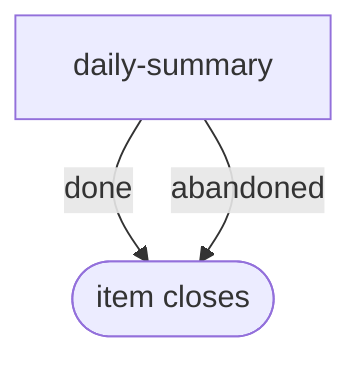

# daily-summary

**Scheduled, not filed by hand.** The engine fires this workflow from the `schedule:` block in its front matter once an operator enables that schedule in config; the bundle only suggests it and enables nothing. Each firing is one item, one pass, no PR.

A scheduled short prose summary of the work closed on one day, grouped by what it improved. 07:00 is deliberate: the guard checks today first, which is empty then, so it reaches yesterday and the summary covers the whole previous day.

**Suggested schedule:** `cron: 0 7 * * *`, `guard: day-unsummarised`.

The graph is `workflows/daily-summary.md`; the step prompts are in `steps/*.md`.

## Flow

Node shape shows who runs each stage: `[ agent-step ]` an ephemeral agent claims and completes it; `{{ human-gate }}` a human decides (the driver assists); `([ terminal ])` where the flow ends. Edge labels are outcomes.

## Steps

| Step | Who | Does |
| --- | --- | --- |
| `daily-summary` | agent | Reads the day's closes from the item description, groups them by theme, attaches the `summary` artifact and ends `done`. `abandoned` is for a driver who drops a summary they do not want. |
