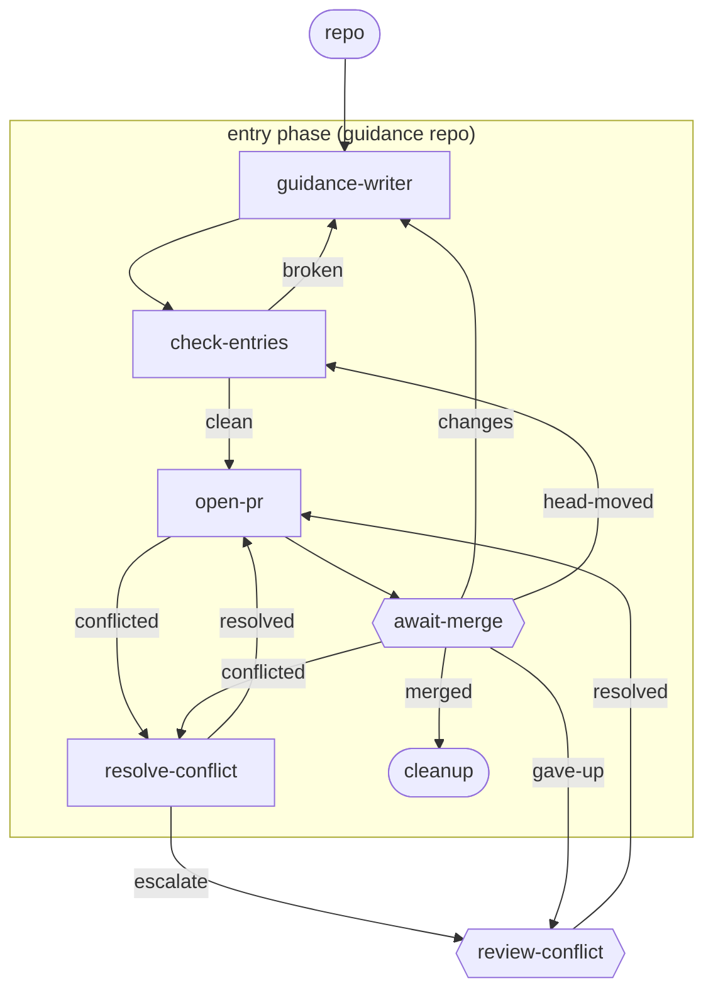

# guidance-entry

**One item, one id, one phase, one PR.** `guidance-writer` reads the brief (the finding behind the change and what the human and driver agreed), then writes, edits or retires guidance entries: new and edited entries are `status: stable`, and retiring sets `deprecated` (never by deleting the file). `check-entries` runs a mechanical conventions check before any human sees the PR, `open-pr` opens an ordinary PR, and the PR merges through the generic await-merge machinery. Merging is the approval: a stable entry is delivered once it is on main.

**Use it when** you change the guidance repo: a new entry, an edit, or retiring one. File it with `lc new item "<title>" --workflow lightcycle/guidance-entry --repo <the guidance repo>`, with a brief that names where the finding came from (an audit, a `review-findings` step, or a conversation) and what was agreed. The item records that source as a `finding` artifact.

**Phases:** `entry` (the guidance repo) only. The guidance repo has no CI, so there are no CI stages and `open-pr` goes straight to the human gate.

The graph is `workflows/guidance-entry.md`; the step prompts are in `steps/*.md`.

## Flow

Node shape shows who runs each stage: `[ agent-step ]` an ephemeral agent claims and completes it; `{{ human-gate }}` a human decides (the driver assists); `([ start / terminal ])` the item's inputs or where the flow ends. Edge labels are outcomes; edges back to an earlier stage are rework loops. Merge and conflict transitions are driven by engine hooks watching the PR - folded into the labelled edges here; exact wiring is in the graph file.

## Steps

| Step | Who | Does |
| --- | --- | --- |
| `guidance-writer` | agent | Writes, edits or retires entries from the brief, following the repo's `CONVENTIONS.md`; every entry is left `stable` (or `deprecated` when retired) with no `verified` line, carries `purpose`, `when` and `why` and no item id, and the finding's source is recorded on the item and in the commit body. |
| `check-entries` | agent | Runs `lc guidance-check` over every changed entry: front matter, `type: Guidance`, inline `applies-to` lists, a concept page per facet, valid step names, valid `status`, no deleted entries, a non-empty `purpose`, `when` and `why`, no item id. Runs again if a push moves the PR head while it waits. |
| `open-pr` | script | Rebases on main, pushes, opens the PR. |
| `await-merge` | human | The human reads the PR and merges it, which is also the approval of every entry in it; or routes changes/feedback back. |
| `resolve-conflict` / `review-conflict` | agent / human | Handle a PR that hits a merge conflict (escalating to a human past the cap). |
| `cleanup` | script, terminal | The item is merged and done. |
