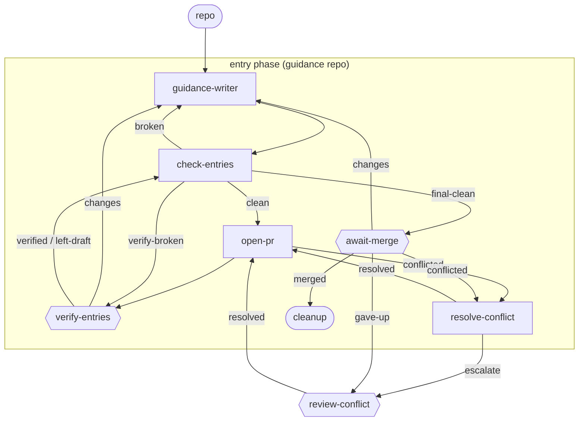

# guidance-entry

**One item, one id, one phase, one PR.** `guidance-writer` reads the brief (the finding behind the change and what the human and driver agreed), then writes, edits or retires guidance entries, always leaving them `draft` (or `deprecated` when retiring - never by deleting the file). `check-entries` runs a mechanical conventions check before any human sees the PR, `verify-entries` is where a human alone marks an entry `stable` with its `verified` record, and the PR merges through the generic await-merge machinery.

**Use it when** you change the guidance repo: a new entry, an edit, or retiring one. File it with `lc new item "<title>" --workflow lightcycle/guidance-entry --repo <the guidance repo>`, with a brief that names where the finding came from (an audit, a `review-findings` step, or a conversation) and what was agreed. The item records that source as a `finding` artifact.

**Phases:** `entry` (the guidance repo) only. The guidance repo has no CI, so there are no CI stages and `open-pr` goes straight to the human gate.

The graph is `workflows/guidance-entry.md`; the step prompts are in `steps/*.md`.

## Flow

Node shape shows who runs each stage: `[ agent-step ]` an ephemeral agent claims and completes it; `{{ human-gate }}` a human decides (the driver assists); `([ start / terminal ])` the item's inputs or where the flow ends. Edge labels are outcomes; edges back to an earlier stage are rework loops. Merge and conflict transitions are driven by engine hooks watching the PR - folded into the labelled edges here; exact wiring is in the graph file.

## Steps

| Step | Who | Does |
| --- | --- | --- |
| `guidance-writer` | agent | Writes, edits or retires entries from the brief, following the repo's `CONVENTIONS.md`; every entry is left `draft` (or `deprecated`) with no `verified` record (except a context-only edit, which keeps both), carries `purpose`, `when` and `why` and no item id, and the finding's source is recorded on the item and in the commit body. |
| `check-entries` | agent | Runs `lc guidance-check` over every changed entry: front matter, `type: Guidance`, inline `applies-to` lists, a concept page per facet, valid step names, valid `status`, no deleted entries, a non-empty `purpose`, `when` and `why`, no item id. An entry whose only change is those three fields keeps its `stable` status and `verified` record. Runs again after the gate, when it also requires every `stable` entry to carry a `verified` record. |
| `open-pr` | agent | Rebases on main, pushes, opens the PR. |
| `verify-entries` | human | The only place an entry becomes `stable`: on the human's explicit per-entry word the driver writes `status: stable` and `verified`, or the human edits the front matter themselves. `left-draft` merges the entries as `draft`, which is never delivered. |
| `await-merge` | human | Merges the PR, or routes changes/feedback back. |
| `resolve-conflict` / `review-conflict` | agent / human | Handle a PR that hits a merge conflict (escalating to a human past the cap). |
| `cleanup` | terminal | The item is merged and done. |
