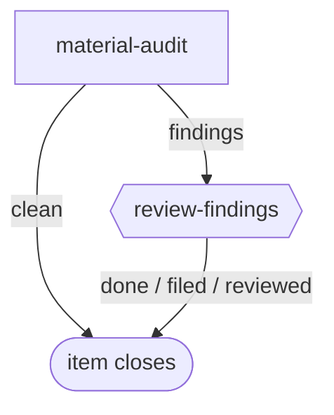

# material-audit

**Scheduled, not filed by hand.** The engine fires this workflow from the `schedule:` block in its front matter once an operator enables that schedule in config; the bundle only suggests it and enables nothing. Each firing is one item, one pass, no PR.

A scheduled audit of the guidance entries and workflow bundles agents are told to follow. It runs only when the material changed since the last firing, files nothing, and edits nothing.

**Suggested schedule:** `cron: 0 9 * * 1`, `guard: materials-changed`.

The graph is `workflows/material-audit.md`; the step prompts are in `steps/*.md`.

## Flow

Node shape shows who runs each stage: `[ agent-step ]` an ephemeral agent claims and completes it; `{{ human-gate }}` a human decides (the driver assists); `([ terminal ])` where the flow ends. Edge labels are outcomes.

## Steps

| Step | Who | Does |
| --- | --- | --- |
| `material-audit` | agent | Applies the guidance and workflow criteria, attaches a `findings` digest on every run, ends `findings` or `clean`. |
| `review-findings` | human | Reads the digest with the driver and files follow-up work if warranted: `filed`, `reviewed` or `done`. |
