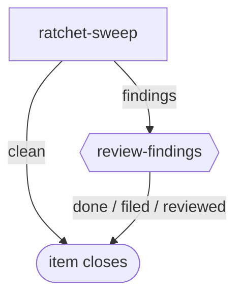

# ratchet-sweep

**Scheduled, not filed by hand.** The engine fires this workflow on a schedule; the bundle only declares it and enables nothing. Each firing is one item, one pass, no PR.

A scheduled sweep of the active repos against the catalog of ratchet guards. It reports which guards a repo lacks, which baselines have stopped shrinking, and what the catalog should gain. With an empty catalog it falls back to a starter list per stack. It files nothing and edits nothing.

The graph is `workflows/ratchet-sweep.md`; the step prompts are in `steps/*.md`.

## Flow

Node shape shows who runs each stage: `[ agent-step ]` an ephemeral agent claims and completes it; `{{ human-gate }}` a human decides (the driver assists); `([ terminal ])` where the flow ends. Edge labels are outcomes.

## Steps

| Step | Who | Does |
| --- | --- | --- |
| `ratchet-sweep` | agent | Finds active repos, checks each against the ratchet entries (or the starter list), attaches a `findings` digest on every run, ends `findings` or `clean`. |
| `review-findings` | human | Reads the digest with the driver and files follow-up work if warranted: `filed`, `reviewed` or `done`. |
