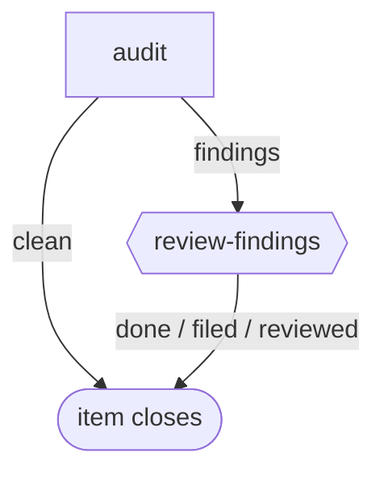

# retro-audit

**Scheduled, not filed by hand.** The engine fires this workflow from the `schedule:` block in its front matter once an operator enables that schedule in config; the bundle only suggests it and enables nothing. Each firing is one item, one pass, no PR.

A scheduled audit of a batch of closed items that carry feedback. It surfaces concrete things to improve in the process or setup, never trends manufactured across unrelated work, and files nothing. It also judges each writer's closing note against the plain-language rule, reading the note from the step that follows the writer.

**Suggested schedule:** `cron: 0 9 * * *`, `name: audit`, `guard: pending-reflections` with `min: 30`.

The graph is `workflows/retro-audit.md`; the step prompts are in `steps/*.md`.

## Flow

Node shape shows who runs each stage: `[ agent-step ]` an ephemeral agent claims and completes it; `{{ human-gate }}` a human decides (the driver assists); `([ terminal ])` where the flow ends. Edge labels are outcomes.

## Steps

| Step | Who | Does |
| --- | --- | --- |
| `audit` | agent | Reads the batch from the item description, applies the four-part bar and the plain-language check, attaches a `findings` digest and ends `findings`, or ends `clean`. |
| `review-findings` | human | Reads the digest with the driver and files follow-up work if warranted: `filed`, `reviewed` or `done`. |
