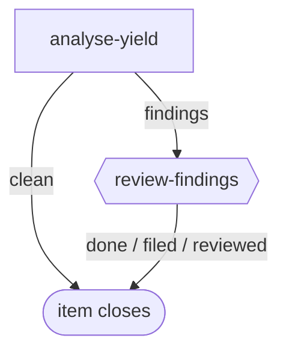

# review-yield

**Scheduled, not filed by hand.** The engine fires this workflow from the `schedule:` block in its front matter once an operator enables that schedule in config; the bundle only suggests it and enables nothing. Each firing is one item, one pass, no PR.

A scheduled judgement of whether agent review is earning its cost. It reads what the engine records (`lc review-yield`), judges each review finding and each escape for severity and kind of failure, and reports per codebase and per review stage the verdicts, rejection rate, catch rate, escapes by source and severity, cost per real finding and the trend against the previous run. An escape is a defect found any time after a review step passed the PR. When the catch rate falls below the floor, or one kind of failure keeps escaping, it proposes a concrete, codebase-agnostic change to the review step and raises a human gate. It never edits a step. It also records a replay set of known-defect PR heads each run, for testing a proposed review-prompt change later; running the replay is a separate item.

**Suggested schedule:** `cron: 0 9 * * 1`, `guard: script:scripts/new-review-activity.py` with `catch-rate-floor: 0.5` and `repeat-min: 3`. Both parameters are required: the guard has no default for either and fails loudly when one is missing. The guard files nothing in a week with no new review verdicts or escapes.

The graph is `workflows/review-yield.md`; the step prompts are in `steps/*.md`.

## Preconditions

The engine only reports a review stage once a step declares `review: <pass-outcome>` and its merge gate declares `sends-back: changes`. Until the bundle's review step and merge gate carry those two frontmatter lines, `lc review-yield` reports `stages: []` and a count of `undeclared_steps`, so every firing reads as no data. The analysis reports that plainly as "no declared review stages", never as a clean result. The two lines are filed separately as workflow work by the engine item that shipped the command.

## Flow

Node shape shows who runs each stage: `[ agent-step ]` an ephemeral agent claims and completes it; `{{ human-gate }}` a human decides (the driver assists); `([ terminal ])` where the flow ends. Edge labels are outcomes.

## Steps

| Step | Who | Does |
| --- | --- | --- |
| `analyse-yield` | agent | Reads the window, judges every finding and escape, computes the figures, attaches `metrics` and `replay-set` every run, and ends `findings` (with a digest and proposals) or `clean`. |
| `review-findings` | human | Reads the digest with the driver and files follow-up work if warranted: `filed`, `reviewed` or `done`. |

## State between runs

The `metrics` and `replay-set` artifacts on each closed item are the only state. The next run finds them through the `previous:` line the guard writes into the item description.
