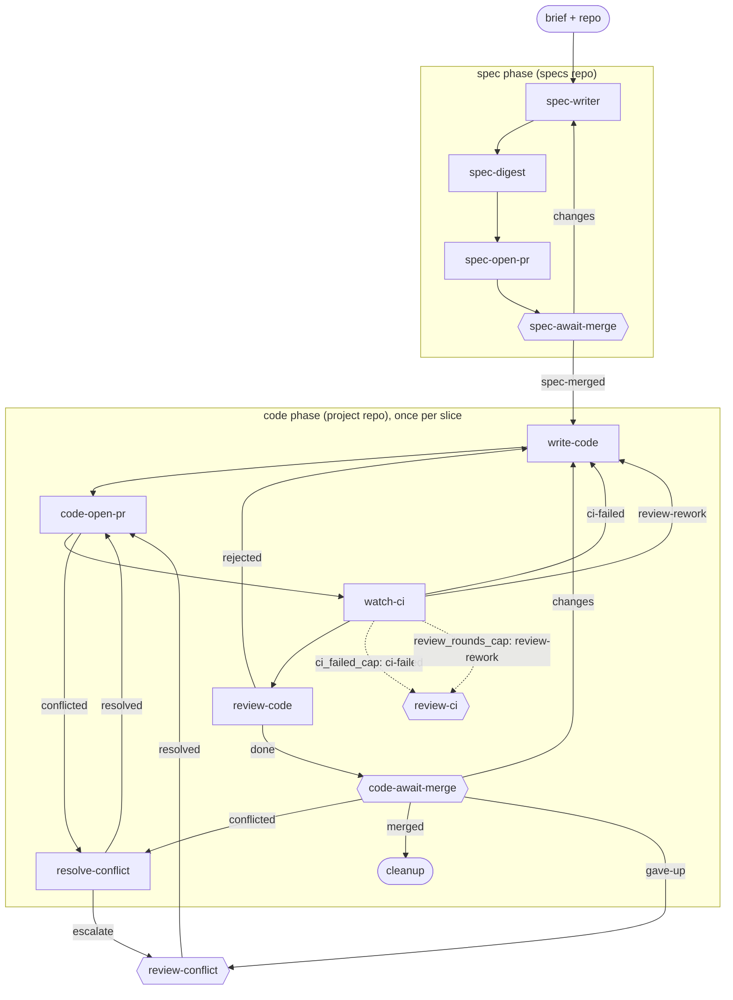

# spec-driven

**One item, one id, from brief to merged code, through two PRs.** A brief settled in co-design becomes a formal spec on a spec PR; once that merges, the same item continues into the code build. The spec PR is the single human review gate before code; the code PR is the merge gate.

**Use it when** the design is best captured as a prose spec that a human reviews and merges before any code is written.

**Phases:** `spec` (specs repo) then `code` (project repo). `open-pr` and `await-merge` appear once per phase.

The graph is `workflows/spec-driven.md`; the step prompts are in `steps/*.md`.

## Flow

Node shape shows who runs each stage: `[ agent-step ]` an ephemeral agent claims and completes it; `{{ human-gate }}` a human decides (the driver assists); `([ start / terminal ])` the item's inputs or where the flow ends. Edge labels are outcomes; edges back to an earlier stage are rework loops. Merge, CI-failure, and conflict transitions are driven by engine hooks watching the PR - folded into the labelled edges here; exact wiring is in the graph file.

## Steps

| Step | Who | Does |
| --- | --- | --- |
| `spec-writer` | agent | Formalizes the brief into a spec on a branch in the specs repo. |
| `spec-digest` | agent | Writes a short plain-language digest of the spec beside it, for the human at the spec gate. It opens with relative links to the brief and the spec, and the brief is attached to the item so the gate shows it beside the spec and digest. A no-change spec gets the same digest on its way to the `no-change` gate. |
| `spec-open-pr` / `spec-await-merge` | script / human | Opens the spec PR; the human reviews and merges it (the review gate). |
| `nochange-open-pr` / `nochange-await-merge` | script / human | The spec PR's second gate: `spec-writer` closes `no-change` when the spec concludes nothing should change. Merging that PR completes the item with no code phase. |
| `write-code` | agent | Implements the spec so every acceptance check passes. For a sliced run it builds only the slice named for that run, read from the spec's `## Delivery`, and rebases onto the slice below it. |
| `code-open-pr` | script | Rebases on the base branch (or the slice below), pushes, opens the code PR. A sliced run adds a `Slice: <name> (<k> of <n>)` line and a `Stacked on:` line to the PR body. |
| `watch-ci` | agent | Watches CI; routes failing CI and correct review comments back to `write-code` (each capped, then `review-ci`). A stacked slice rebases onto the slice below, not the default branch. |
| `review-code` | agent | Reviews the diff against the spec and primes the human gate; bounces back on defects. For a sliced run it reviews against that slice's `## Delivery` entry and never reviews the lower slices' commits. |
| `code-await-merge` | human | Merges the code PR, or routes changes/feedback back. For a sliced run the summary says which slice of how many this is and what it stacks on. |
| `resolve-conflict` / `review-conflict` | agent / human | Handle a PR that hits a merge conflict (escalating to a human past the cap), who resolves it by hand and re-enters the PR/CI cycle, or abandons the item. A stacked slice rebases onto the slice below, not the default branch. |
| `cleanup` | script, terminal | The item is merged and done. |

Every spec carries a `## Delivery` section saying whether it ships as one PR or a stack of small slices; a `Delivery: one PR` or `Delivery: stack` line in the brief pins the outcome.

A spec whose `## Delivery` lists slices runs the `code` phase once per slice, as a stack of PRs: each slice has its own branch, PR and merge gate, and `cleanup` runs once after the last slice merges. A `Delivery: one PR` spec attaches no slices and the phase runs once.

The slice size guide comes from two optional workflow config keys, `slice-lines` and `slice-lines-limit`. The order is the target repo's `CLAUDE.md` guide first, then the operator's value in the config file's `workflow-lightcycle-spec-driven:` block, then the bundle seed in `steps/spec-writer.md` (100 and 400). With no operator value set the seeds apply.
